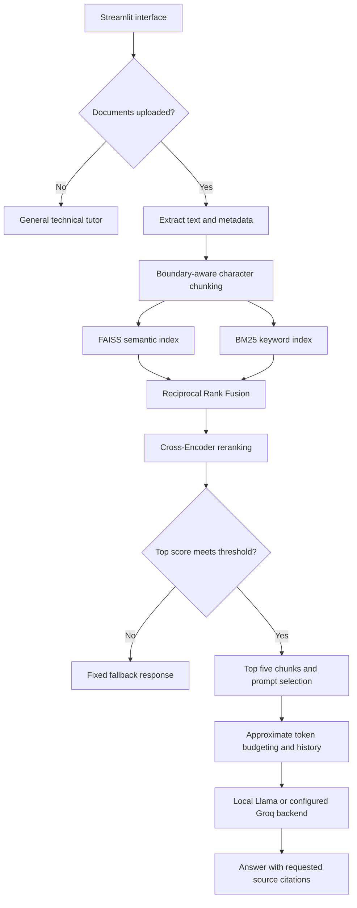

# 💬 Local AI Knowledge Assistant

### A Two-Stage, Object-Oriented RAG System & Technical Tutor

A privacy-focused, document-aware AI assistant and technical tutor designed to run local language models on consumer hardware.

The system uses an optimized, 4-bit quantized **Llama 3.1 8B Instruct (`Q4_K_M` GGUF)** model through `llama.cpp` for local inference. It implements a custom, framework-free, two-stage hybrid retrieval pipeline combining **dense vector search (FAISS)** and **sparse keyword search (BM25)**, followed by **Reciprocal Rank Fusion (RRF)** and optional cross-encoder reranking.

By grounding responses in retrieved document content, the assistant provides context-aware answers with source attribution while supporting document-based learning and technical Q&A.

<p align="center">
  
  
  
  
  
  
</p>

---

> **Privacy note:** Local inference can operate offline once the required model and dependencies are available. Optional Groq inference requires an internet connection and sends prompts to the external API. Deploying the application to Streamlit Community Cloud also means the app runs in a cloud environment rather than entirely on your own machine.

---

## 📌 Table of Contents

- [📊 Benchmark Results — SQuAD v2 Development Evaluation](#benchmark-results--squad-v2-development-evaluation)
- [🏗️ System Architecture](#system-architecture)
- [✨ Core Engineering Highlights](#core-engineering-highlights)
- [🧰 Technology Stack](#technology-stack)
- [📁 Project Structure](#project-structure)
- [🚀 Installation](#installation)
- [🧠 Model Configuration and Cloud Fallback](#model-configuration-and-cloud-fallback)
- [🔐 Environment Configuration](#environment-configuration)
- [▶️ Running the Application](#running-the-application)
- [🚀 Live Demo and Deployment](#live-demo-and-deployment)

---

<a id="benchmark-results--squad-v2-development-evaluation"></a>

## 📊 Benchmark Results — SQuAD v2 Development Evaluation

The local Llama 3.1 RAG pipeline was evaluated on a small, custom benchmark constructed from SQuAD v2:

- **Source corpus:** 80 passage files extracted from SQuAD v2.
- **Total questions:** 100.
- **Answerable questions:** 85.
- **Unanswerable questions:** 15.
- **Retrieved context:** Top 5 chunks per question.
- **Generation temperature:** 0.0.
- **Inference backend:** Local Llama 3.1 GGUF through `llama.cpp`.

These questions have informed prompt and relevance-threshold development. Results should therefore be interpreted as **development-set performance**, rather than performance on an untouched held-out test set.

### Retrieval Performance

Retrieval combines Sentence-Transformer embeddings and FAISS semantic search with BM25 keyword search. Reciprocal Rank Fusion merges the candidate rankings, and a Cross-Encoder reranks the candidates before selecting the final five chunks.

| Metric | Result | Interpretation |
|---|---:|---|
| **Source Hit Rate @ 5** | **98.8%** | A chunk from the relevant source passage appeared in the top five results for 84 of 85 answerable questions. |
| **Source-passage MRR** | **0.949** | Measures how highly the first relevant source passage ranks in the retrieved results. |
| **Context ROUGE-1 Recall** | **98.8%** | Average reference-answer unigram coverage within the combined retrieved context. |
| **Average Retrieval Latency** | **90.4 ms** | Average time for query embedding, semantic search, keyword search, rank fusion, and Cross-Encoder reranking. |

**Source-based relevance:** Each benchmark question retains the filename of its relevant SQuAD passage. Source Hit@5 and MRR use this source identity rather than answer-word overlap.

Each source file represents one original passage, which may be divided into multiple chunks. Retrieving a chunk from the correct source passage does not necessarily prove that the selected chunk contains the complete answer.

Context ROUGE-1 recall remains a separate lexical-overlap diagnostic; it is not a measure of factual correctness.

### Answer Generation Performance

The generation metrics below are averaged across the **85 answerable questions**.

| Metric | Result | Interpretation |
|---|---:|---|
| **Answer ROUGE-1 Recall** | **92.1%** | Measures reference-answer unigram coverage in generated answers. |
| **Answer ROUGE-1 F1** | **25.8%** | Balances unigram-overlap precision and recall. |
| **Answer ROUGE-L F1** | **25.8%** | Measures sequence overlap using the longest common subsequence. |
| **Mean Semantic Cosine Similarity** | **0.444** | Average embedding cosine similarity between generated and reference answers. |
| **Average Generation Latency** | **3,563 ms** | Average time spent in the answer-generation call, including prompt preparation and inference. |

**Interpretation:** High answer recall indicates substantial reference-word coverage. It does **not** mean that 92.1% of answers are factually correct.

The lower F1 scores may partly reflect a mismatch between short SQuAD reference answers and longer generated responses. Manual error analysis is needed to distinguish harmless extra wording from irrelevant or unsupported content.

Semantic cosine similarity is an embedding-based diagnostic, not an accuracy percentage. In the current evaluator, bracketed citations are removed before ROUGE scoring but remain in the text used for semantic similarity.

### Unsupported-Question Handling

| Metric | Result |
|---|---:|
| **Correctly rejected unanswerable questions** | **5 / 15** |
| **Unanswerable-question rejection rate** | **33.3%** |

The evaluator detects refusals using predefined phrases in generated responses. This is a heuristic and does not replace manual assessment of answer support.

The system includes a Cross-Encoder relevance gate and a fixed fallback message. However, topical relevance does not establish answerability: a passage may discuss the right subject without containing the requested fact.

The low rejection rate is a known limitation. Reliable unsupported-question handling has **not** been established.

### Reproducing the Evaluation

Install the application and evaluation dependencies and configure the local GGUF model. Local inference requires `llama-cpp-python` in addition to the relevant Python packages.

Run these commands from the repository root:

```bash
# Run lightweight regression tests without loading the language model.
python -m unittest discover -s tests -v

# Download SQuAD v2 and construct the benchmark.
python evaluation/build_large_benchmark.py

# Run retrieval and local answer-generation evaluation.
python evaluation/evaluate.py
```

The benchmark builder requires an internet connection. It creates:

```text
evaluation/
├── benchmark/
│   ├── documents/                 # Source passage files
│   └── questions.json             # Questions, reference answers, and relevant source IDs
└── results_source_grounded.json   # Per-question evaluation results
```

The builder recreates its benchmark document directory while leaving the application's `data/` directory unchanged. The evaluator writes revised results separately from the historical `evaluation/results.json` file.

Latency depends on hardware, model configuration, document size, and runtime conditions. Reported times are averages from this run, not production latency guarantees.

### Evaluation Limitations

- **Small development set:** Results cover 100 questions and a limited selection of SQuAD passages.
- **No untouched test set:** Prompt and threshold development have used these questions.
- **Source-level retrieval evaluation:** Correct source identity does not guarantee complete answer-bearing chunk retrieval.
- **Lexical generation metrics:** ROUGE measures text overlap rather than factual correctness or citation validity.
- **Heuristic refusal detection:** Rejection scoring uses phrase matching and requires manual verification.
- **Incomplete document-wide coverage:** Generation uses the top five retrieved chunks. Requests such as “list all algorithms in this document” may omit information elsewhere.
- **No controlled baseline improvement claim:** The historical 69.4% answer-recall baseline used a different question set, so it should not be presented as a directly comparable improvement to 92.1%.
- **Limited operational evaluation:** These results do not establish concurrent-user capacity, production reliability, or performance on arbitrary uploaded documents.

### Next Evaluation Priorities

1. Reserve a separate held-out test set before further tuning.
2. Compare semantic-only, BM25-only, hybrid, and reranked retrieval on identical questions.
3. Improve unsupported-question rejection while measuring false rejections of answerable questions.
4. Evaluate factual correctness and citation support through manual review.
5. Add document-wide inventory and summary questions.
6. Record hardware details and measure p50/p95 end-to-end latency.

---

<a id="system-architecture"></a>

## 🏗️ System Architecture



Both factual questions and explicit document-summary requests pass the relevance gate. Summary requests receive a different prompt, but still use the retrieved chunks rather than the complete document.

---

<a id="core-engineering-highlights"></a>

## ✨ Core Engineering Highlights

### Shared Local and Cloud Inference

`src/llm.py` shares prompt construction, context formatting, and conversation-history handling through `_LLMBase`.

- **`LocalLLM`:** Runs a local GGUF model through `llama.cpp`.
- **`GroqLLM`:** Uses a configured hosted model through the Groq SDK.
- **Lazy imports:** Backend-specific dependencies are imported when that backend is initialized or used.

### Document Ingestion and Chunking

`src/ingestion.py` processes PDF, DOCX, TXT, and Markdown uploads.

- **PDF extraction:** PyMuPDF uses `sort=True` to attempt reading-order reconstruction. Complex layouts may still require inspection.
- **DOCX extraction:** Paragraphs and tables are read in document order. Table cells are formatted as pipe-separated text.
- **Character-based windows:** Chunks target **900 characters** with approximately **150 characters of overlap**.
- **Preferred boundaries:** Paragraph breaks, newlines, sentence endings, then spaces.
- **Word-boundary adjustment:** Overlap starts are adjusted to avoid starting mid-word where possible.
- **Metadata:** Chunks retain source filenames and PDF page numbers for source attribution.

This is boundary-aware character chunking, rather than embedding-based semantic chunking.

### Hybrid Retrieval and Reranking

`src/retriever.py` searches the same chunks using two complementary methods:

| Stage | Implementation | Purpose |
| --- | --- | --- |
| Semantic search | Normalized `all-MiniLM-L6-v2` embeddings and FAISS `IndexFlatIP` | Find passages with similar meaning. |
| Keyword search | Regex tokenization and `BM25Okapi` | Find matching terms and identifiers. |
| Rank fusion | Reciprocal Rank Fusion, `k = 60` | Combine semantic and keyword rankings. |
| Reranking | `cross-encoder/ms-marco-MiniLM-L-6-v2` | Score question–chunk pairs and reorder candidates. |
| Final selection | Top 5 chunks by default | Supply a limited context to generation. |

With `TOP_K=5`, each initial search considers up to 20 candidates, subject to corpus size. BM25 candidates must have positive scores. Fusion retains up to 20 candidates for Cross-Encoder reranking.

### Relevance Gating and Prompt Routing

The highest Cross-Encoder score is checked against a default threshold of **−5.0**. Below-threshold requests receive the fixed fallback without an LLM generation call.

Explicit document-summary requests use a summary prompt; other requests use a factual question-answering prompt. Both paths apply the relevance check.

The threshold was selected using development questions. Cross-Encoder scores are not probabilities, and passing the threshold does not prove that the context contains the answer.

### Context and History Management

The application formats up to five retrieved chunks with source metadata. It estimates token usage from character counts and trims retained conversation history against the configured context budget.

This is **approximate token budgeting**, not exact tokenizer-based accounting. Prompts request source citations and context-grounded responses; those instructions do not guarantee factual correctness.

---

<a id="technology-stack"></a>

## 🧰 Technology Stack

| Component | Technology |
| --- | --- |
| Runtime | Python 3.11+ |
| Interface | Streamlit |
| Local inference | `llama-cpp-python` |
| Local model | Llama 3.1 8B Instruct, `Q4_K_M` GGUF |
| Optional cloud inference | Groq Python SDK |
| Embeddings | Sentence Transformers, `all-MiniLM-L6-v2` |
| Vector search | FAISS `IndexFlatIP` |
| Keyword search | `rank-bm25`, `BM25Okapi` |
| Reranking | Cross-Encoder, `ms-marco-MiniLM-L-6-v2` |
| Document parsing | PyMuPDF and `python-docx` |
| Evaluation | ROUGE, embedding cosine similarity, source-based retrieval metrics |

---

<a id="project-structure"></a>

## 📁 Project Structure

```text
local-ai-knowledge-assistant/
├── app.py
├── requirements.txt
├── README.md
├── models/
│   └── Meta-Llama-3.1-8B-Instruct-Q4_K_M.gguf
├── src/
│   ├── __init__.py
│   ├── config.py
│   ├── ingestion.py
│   ├── retriever.py
│   └── llm.py
├── evaluation/
│   ├── build_large_benchmark.py
│   ├── evaluate.py
│   ├── metrics.py
│   ├── benchmark/
│   │   ├── documents/
│   │   └── questions.json
│   └── results_source_grounded.json
└── tests/
    └── test_rag_regressions.py
```

The benchmark directory and revised results are generated by the evaluation commands. Historical question and result files may also remain in the repository.

| File | Responsibility |
| --- | --- |
| `app.py` | Streamlit interface and application orchestration. |
| `src/config.py` | Model paths, environment variables, and runtime settings. |
| `src/ingestion.py` | File parsing, text cleaning, and chunking. |
| `src/retriever.py` | Semantic search, keyword search, fusion, and reranking. |
| `src/llm.py` | Prompt construction, inference backends, and fallback routing. |
| `evaluation/metrics.py` | Source-based Hit@K and reciprocal-rank calculations. |
| `tests/test_rag_regressions.py` | Lightweight checks for routing, metrics, configuration, and benchmark construction. |

Keep the GGUF model binary outside version control and configure its local path before running local inference.

---

<a id="installation"></a>

## 🚀 Installation

### 1. Clone the Repository

```bash
git clone https://github.com/aathiabhishek/local-ai-knowledge-assistant.git
cd local-ai-knowledge-assistant
```

### 2. Create a Virtual Environment

```bash
python3 -m venv .venv
source .venv/bin/activate
```

On Windows, activate it with:

```powershell
.venv\Scripts\Activate.ps1
```

### 3. Install Dependencies

```bash
python -m pip install --upgrade pip
python -m pip install -r requirements.txt
```

For local GGUF inference, also install `llama-cpp-python` using a build appropriate for your hardware. GPU acceleration depends on the installed build and runtime configuration.

---

<a id="model-configuration-and-cloud-fallback"></a>

## 🧠 Model Configuration and Cloud Fallback

### Local Inference

Place the model at the default location, or set `MODEL_PATH` to its actual path:

```text
models/Meta-Llama-3.1-8B-Instruct-Q4_K_M.gguf
```

### Optional Cloud Fallback

When the local model is unavailable or cannot initialize, the application can use Groq if a valid API key is configured.

The configured cloud model is shared by inference and the interface. `GROQ_MODEL` takes precedence over `CLOUD_MODEL_NAME` when both are set. Hosted inference sends prompts and relevant document excerpts to the provider.

---

<a id="environment-configuration"></a>

## 🔐 Environment Configuration

Configure the following values in your environment or a local `.env` file:

```dotenv
# Local model and optional cloud fallback
MODEL_PATH=models/Meta-Llama-3.1-8B-Instruct-Q4_K_M.gguf
GROQ_API_KEY=your_groq_api_key_here
CLOUD_MODEL_NAME=openai/gpt-oss-120b

# Embedding and reranking models
EMBEDDING_MODEL=sentence-transformers/all-MiniLM-L6-v2
RERANKER_MODEL=cross-encoder/ms-marco-MiniLM-L-6-v2

# Retrieval, context, and hardware settings
TOP_K=5
MAX_HISTORY_MESSAGES=8
N_CTX=8192
N_THREADS=8
N_GPU_LAYERS=-1
MAX_NEW_TOKENS=2048

# Character-based chunking
CHUNK_SIZE=900
CHUNK_OVERLAP=150
```

Keep actual API keys out of version control. Hardware settings should be adjusted to the capabilities of the local machine.

---

<a id="running-the-application"></a>

## ▶️ Running the Application

### Launch the Interface

```bash
streamlit run app.py
```

Upload a supported document to use retrieval-augmented question answering, or use the general tutor without documents.

### Run Regression Tests

```bash
python -m unittest discover -s tests -v
```

These tests use small artificial examples and do not load the language model.

### Run the Local Benchmark

```bash
python evaluation/build_large_benchmark.py
python evaluation/evaluate.py
```

The benchmark loads documents automatically and requires the local GGUF model; uploading files through the interface is not required.

---

<a id="live-demo-and-deployment"></a>

## 🚀 Live Demo and Deployment

**[Launch the Streamlit App](https://local-ai-knowledge-assistant.streamlit.app/)**

Explore document-based question answering and technical assistance through the browser interface.

The application is deployed using [Streamlit Community Cloud](https://streamlit.io/cloud) and connected to this repository for updates.

| Setting | Details |
| --- | --- |
| Platform | Streamlit Community Cloud |
| Framework | Streamlit |
| Secrets | Configured through deployment secrets rather than committed files. |
| Local inference | Requires the GGUF file and suitable runtime resources. |
| Cloud inference | Requires a valid Groq API key and internet access. |

Deployment in the cloud does not provide the same privacy properties as running the application entirely on your own machine.
